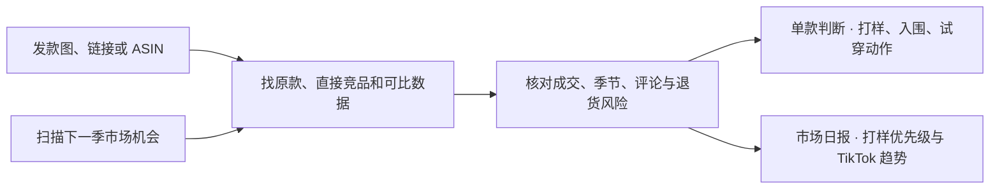

# TikTok × 亚马逊美国站女装趋势追踪与选品

**发现正在起量的女装，验证下一季值得打样的款式。**

`TikTok Shop US` · `Amazon US` · `女装开发` · `款式验证` · `Agent Skills`

在 TikTok 刷到一件突然起量的品，怎么判断现在跟还有没有机会？在亚马逊看到销量很高的父体，怎么确认卖的是你想做的版型？这套 Skill 帮女装设计师、商品企划和跨境卖家查到足够的证据，决定要不要买样、第一版怎么试穿、能不能进开发清单。

项目提供两个可独立安装的 Agent Skills。你可以丢一张款图查同版竞品，也可以每隔两天扫一次市场，优先找淡季仍有成交、下一季值得提前打样的四季款。

[看一份出样建议](examples/product-research.md) · [看一期市场日报](examples/market-report.md) · [快速开始](#快速开始) · [数据与运行手册](docs/workflows.md) · [17 项选品策略](#17-项选品策略) · [订阅与更新](#订阅与更新)

| 你要做什么 | 入口 | 拿到什么 |
|---|---|---|
| **我有一款，想判断值不值得做** | [美国女装选品验证](skills/us-womenswear-product-research/SKILL.md) | 原款与竞品、价格与成交、四季需求、入围状态、第一版打样与试穿建议 |
| **我想提前找下一季的机会** | [美国女装市场日报](skills/us-womenswear-market-report/SKILL.md) | 本期变化、四季款优先的打样候选、一个 TikTok 新趋势，以及下一步要补的证据 |

## 你能用它做什么

- **刷到一个起量款，判断现在值不值得跟。** 对齐两个完整时间窗，同时查销量、新增达人和视频。再看订单是否过度依赖某条素材、买家问的是哪件单品。
- **拿着一张款图，找同版竞品和下一季证据。** 查亚马逊价带、同父体逐月销量和新卖家持续出单，同时对照品牌、零售商品页和评论。商品链接混售不同版型时，单独说明目标款的证据。
- **看到差评，知道第一版具体改什么。** 例如宽袖开衫出现袖口勾包，把问题落成同料同版的两件对照样，试抬手、背包和叠穿，再看是否保留宽袖垂感。
- **做下一季企划，优先找能跨季卖的款。** 日报先排四季款和跨季潜力款，再留 **1 个 TikTok 新趋势位**。每款给打样、跟踪或暂缓动作，并写下一轮要补的证据。

## 快速开始

1. 下载或克隆本仓库。把 `skills/` 下需要的整个 Skill 目录复制到所用工具的 Skills 目录。在 Codex 项目中，可以放到项目根目录的 `.agents/skills/`。同时保留其 `SKILL.md`、`references/` 和 `agents/`。
2. 有 FastMoss 和卖家精灵连接时，可以分别查询 TikTok Shop 与 Amazon US 的市场指标。也可从公开商品页、原视频、评论或自己提供的表格开始。输出会标注数据来源、统计窗口和未取到的字段。
3. 在选品对话中直接发款式，或用下面的提示词明确指定 Skill。

**发一款，做全渠道调研**

> 用 `$us-womenswear-product-research` 调研这件宽袖针织开衫。判断能不能做四季款、适不适合进下一季清单，以及第一版该改哪里。

可以发款图、设计图、商品链接、TikTok 视频或 ASIN。支持自动选择 Skill 的工具可根据选品语境识别发款意图。也可指定只看评论、只查某个平台或做简短快评。

**手动生成一期市场日报**

> 用 `$us-womenswear-market-report` 做一期美国女装市场日报。优先找下一季值得打样的四季款，保留一个值得跟进的 TikTok 新趋势。

需要每隔两天自动运行时，在应用的定时任务里设置上述调用、报告关注范围和保存位置。定时频率和数据源各自配置。

## 查看示例

两个示例均为**模拟数据**，展示证据怎么写、不同结论怎么分。

| 示例 | 可以看到的交付 |
|---|---|
| [单款调研 · 宽袖针织开衫](examples/product-research.md) | 原款与近款的区分、同父体逐月门槛、评论样本、首版样衣的对照试验 |
| [市场日报 · 下一季打样清单](examples/market-report.md) | 四季款候选排序、同期市场信号、一个 TikTok 趋势位、每款下一步 |

**一分钟预览。** 在开衫示例里，TikTok 成交上升，但新增带货达人减少。买家反复提到袖口勾包，同版亚马逊父体又有一个月日均恰好 100 件。结论是先做两件袖口对照样，暂放春夏观察池。

## 工作流程



| 证据 | 回答的问题 | 核对重点 |
|---|---|---|
| **TikTok Shop US** | 这款还在起量吗？ | 先核对原视频挂车和实际商品，再用可比较的时间窗看销量、新增达人和视频、广告归因。有无单条素材贡献过高。 |
| **Amazon US** | 同版的规模和入场机会怎样？ | 对齐用途、版型和价带，查搜索季节性和同一父 ASIN 的月度成交。核对新卖家独立入场，排除老父体新变体带来的错判。 |
| **品牌与零售商品页** | 市场用什么面料、价位和穿法卖类似款？ | 对照同款、高相似款和局部参考，核查页面展示的面料、规格、标价与穿着定位。 |
| **买家评论与售后** | 买家为什么买、哪里最可能被退？ | 给不同样本各自的分母。按部位、情景和后果归纳体验，把问题落实到样衣、生产工艺或商品描述。 |

### 常用场景

| 手上有什么 | 推荐查法 | 先做哪个决定 |
|---|---|---|
| 一张女装款图 | 提取美式英文结构词，找原款及直接竞品，再查平台成交和评价。 | 原款能否确认，哪些同版竞品可以比。 |
| 一个 TikTok 商品或视频链接 | 核对挂车商品，比较同款两个完整的销量窗口、达人扩散和可读评论。 | 现在适合试样还是继续看起量是否延续。 |
| 一个亚马逊 ASIN | 查父子变体、历史月销、旺季价带及同版新卖家，再抽查可归属的评论。 | 整链接规模能否支持这个版型，哪里还能差异化。 |
| 一张下一季开发清单 | 按四季需求、实际上市窗口和试穿风险排优先级。对跨季证据薄的款另列待查月份。 | 先打哪几款、哪款暂缓、每款先试什么。 |

[查看具体取数顺序、报告配置和缺数时的写法](docs/workflows.md)

## 判断口径

- **四季款。** 同时看暖季外搭、过渡季与冷季叠穿是否成立，以及同版同主体面料是否有跨季成交。优先查近 **12 个完整自然月**，重点看淡季是否仍有持续交易。记录不足时标为「有跨季潜力」或「数据不足」。
- **季节清单。** Amazon US 的默认规模线为**一个父 ASIN 在对应旺季连续三个自然月，每个月日均销量都严格大于 100 件**。这个参数可按任务调整。新卖家能否进入、售后风险和打样价值分别评估。
- **首版打样。** 每项建议连回具体评论或结构证据，写清要保留的卖点、要改的部位、对照样和试穿通过标准。
- **市场变化。** 隔日运行是报告节奏。TikTok 可在逐日数据齐全时比较两个完整的两天窗口。Amazon 的周度搜索与月度商品数据按实际更新周期记录。整条商品、单个变体与类目估算分别注明。

## 17 项选品策略

按问题选策略做起筛，给每条命中记录留实际数值和待复核项。下表是按美国市场使用的可调预设；涉及正式开品，还要核对同版成交、季节、入场与退货风险。 [查看工具参数和复核办法](skills/us-womenswear-product-research/references/amazon-tactics.md)

| 方向 | 策略 | 默认起筛或判断 |
|---|---|---|
| 新品 | 新品快速爆发 | 上架 ≤2 个月，月销 ≥300，评分数 ≤100。 |
| 新品 | 隐形爆款 | 上架 ≤3 个月，月销 ≥500，评分数 ≤50。 |
| 关键词 | ABA 高增长趋势词 | 月搜索 ≥3,000，点击前三 ASIN 合计 <60%，再核对近三月增长。 |
| 关键词 | 流量分散关键词 | 月搜索 ≥5,000，点击前三 ASIN 合计 <50%。 |
| 关键词 | 标题密度漏洞 | 首页标题包含该词的商品数 ≤5，再核对词与款式是否相关。 |
| 缺陷 | 热销低评分产品 | 月销 ≥1,000、星级 ≤4.2，查其中可通过设计改善的问题。 |
| 缺陷 | 评论语义分析 | 按问题发生的部位、动作、后果与样本频次归纳。 |
| 类目 | 低品牌垄断类目 | 同一统计范围内品牌集中度 <45%。 |
| 类目 | 高新品占比市场 | 新品占比 >5%，新品平均月销 ≥100。 |
| 类目 | 高毛利轻小品 | 工具估算 FBA 费 ≤$4、估算毛利率 ≥50%，再用实际成本复算。 |
| 流量 | 自然流量反查 | 分开核对自然词条和自然访问；词条占比的初筛线为 >60%。 |
| 变体 | 变体拆解 | 对照同父体同月的颜色、尺码、长度和组合，查有需求的空缺。 |
| 专项 | 本土溢价降维 | 美国卖家在售，售价 ≥$35、月销 ≥500。 |
| 专项 | FBM 拦截 | 商家发货、月销 ≥300，再比较交付承诺与产品差异。 |
| 专项 | 低质量 Listing 高销量 | 商品页质量分 ≤60、月销 ≥400，再核对页面可改善处。 |
| 专项 | 高客单长尾 | 关键词样本均价 ≥$80、月搜索 500–4,000、广告竞品 ≤10。 |
| 专项 | 季节前置 | 历史相邻两个月同一关键词环比 >100%，再核对多年度和销量。 |

## 仓库结构

```text
skills/
  us-womenswear-product-research/   单款选品与打样验证，可独立安装
  us-womenswear-market-report/      下一季市场扫描和日报，可独立安装
examples/
  product-research.md               宽袖开衫完整调研示例
  market-report.md                  四季款优先的市场日报示例
docs/
  workflows.md                      取数、运行、报告口径与常见问题
```

## 致谢与来源

| 参考项目 | 借鉴的方法 |
|---|---|
| [FastMoss Skills](https://github.com/FastMoss/fastmoss-skills) | 同期比较成交、达人和视频，核对推广集中度与跟款时机 |
| [卖家精灵 Skills](https://github.com/opensellersprite/sellersprite-skills) | 季节前置、低评分数新品验证、变体和关键词筛选 |
| [SeaLeap Amazon Skills](https://github.com/xjli360/sealeap-amazon-skills) | 服饰竞品对齐，把合身度和退货线索变成样衣验证 |
| [Nexscope eCommerce Skills](https://github.com/nexscope-ai/eCommerce-Skills) | 按主题、频次和使用后果归纳评论，确定设计改动优先级 |

[查看引用的具体工作流和版本](skills/us-womenswear-product-research/references/sources.md)

## 订阅与更新

- **Star 收藏。** 开下一季选题会、看到有意思的款式或需要复核评论时，可以回来看示例和策略。
- **Watch 关注仓库更新。** 在 GitHub 仓库页可以选择接收的活动通知，适合跟进选品规则、示例和使用说明。
- **生成自己的隔日市场日报。** 安装市场日报 Skill，在自己的应用里设置关注品类、目标季节、数据连接和运行频率，然后按市场范围生成第一期基线。
